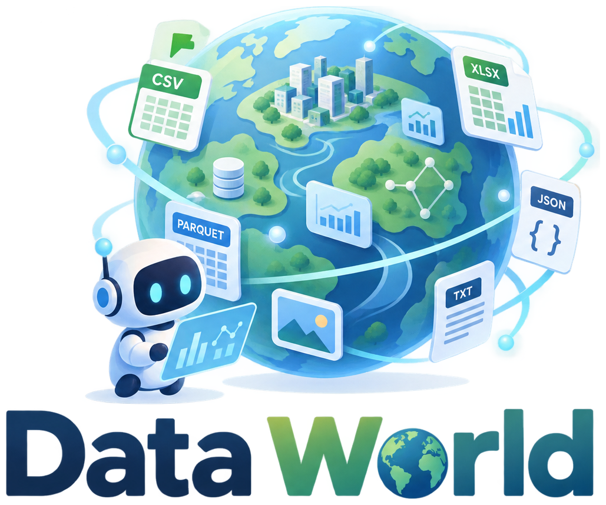
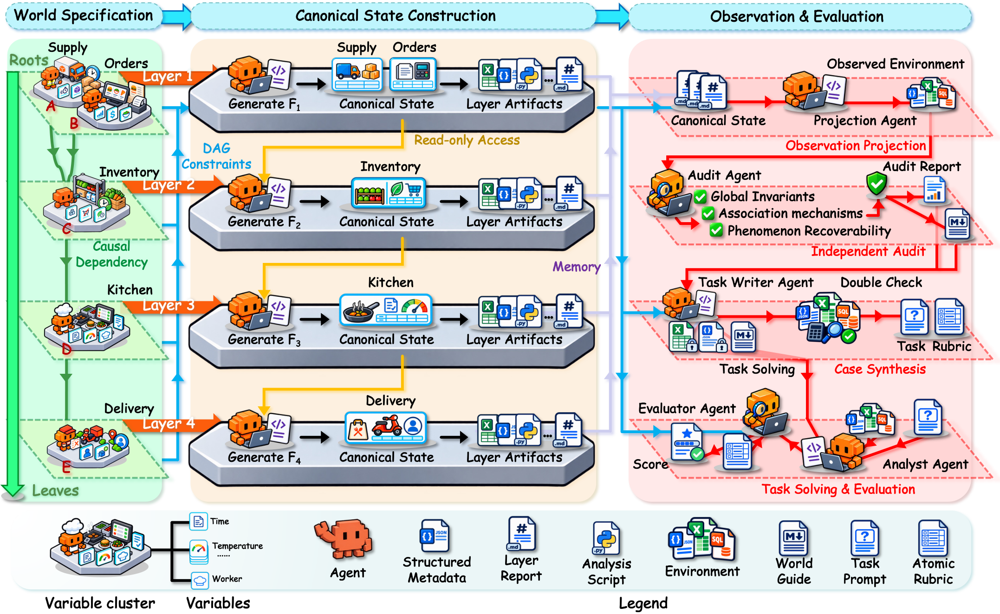
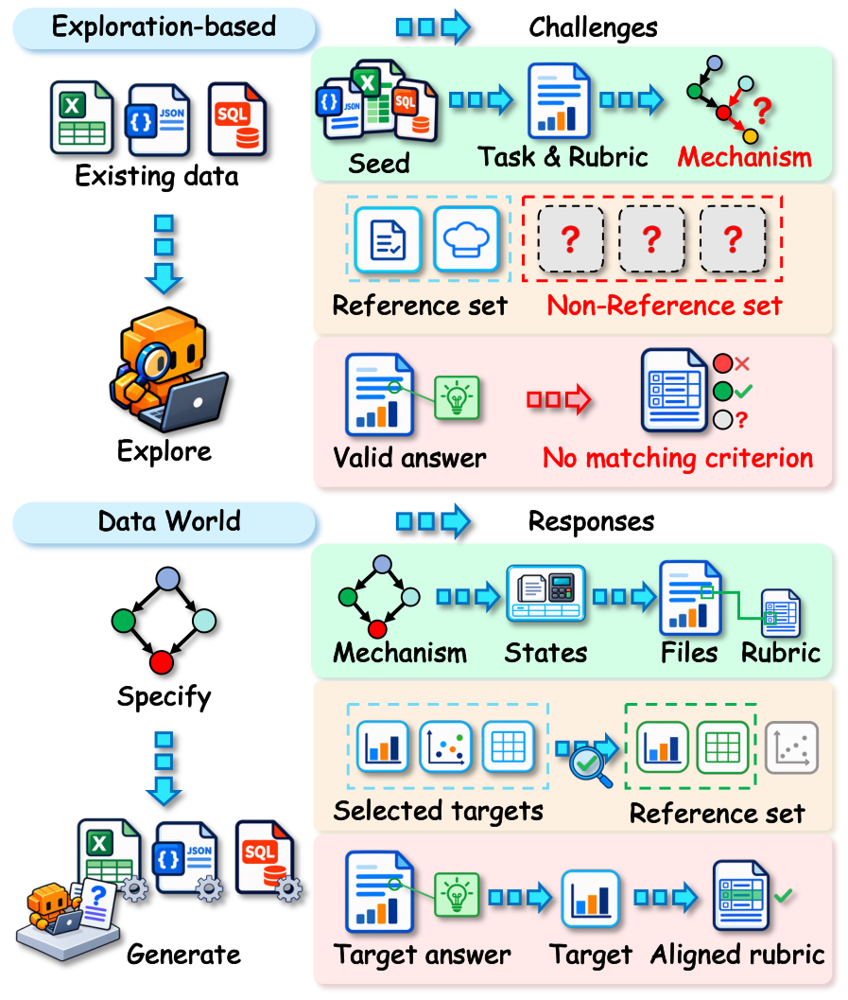

<div align="center">
  
  <p><strong>Scaling Data Environments from Scratch</strong></p>
  <p>Specify the world behind the files. Generate the data. Ground the supervision.</p>
  <p>
    
    
    
  </p>
  <p><strong>English</strong> · <a href="README.zh-CN.md">中文</a></p>
  <p>
    <a href="#overview">Overview</a> ·
    <a href="#quick-start">Quick Start</a> ·
    <a href="doc/README.md">Documentation</a>
  </p>
</div>

---

## Overview

**Data World is a mechanism-first, multi-agent engine for synthesizing data-analysis environments, tasks, and rubrics from scratch.** Rather than exploring existing files and writing criteria for whichever findings happen to be discovered, it specifies the generative mechanisms first, builds a coherent canonical state, and then produces imperfect analyst-visible observations. An independent auditor checks the specified relationships and whether targeted findings can be recovered from those files.

The result is more than a collection of synthetic tables: it is a **data world with grounded analytical targets**, supporting evaluation and rubric-based rewards for data agents.

<p align="center">
  
  <br>
  <sub>From a dependency DAG to observed files, audited targets, and task-specific supervision.</sub>
</p>

| Design | What it provides |
|---|---|
| **Mechanisms before files** | A world contract fixes entities, timelines, generative relationships, invariants, and observation systems before data generation. |
| **Layer-wise canonical state** | DAG layers are built in topological order; committed upstream state is read-only input to subsequent layers. |
| **Imperfect observations** | Missingness, delays, identifier mismatches, duplicates, and drift arise from explicit observation mechanisms, not arbitrary noise alone. |
| **Independent audit** | A separate agent checks relationships, global invariants, and target recoverability, recording an audit and a world guide. |
| **Grounded rubrics** | Tasks follow upstream causes or downstream consequences; atomic criteria separate `data_computation` from `insight_discovery`. |

<details>
<summary><strong>Why specify the world before generating its files?</strong></summary>

Exploring existing data can miss valid findings and leave them without matching evaluation criteria. Data World uses the generative record to establish selected targets and ground their rubrics, then audits their recoverability from observed files. This does not guarantee exhaustive coverage of every valid insight.

<p align="center">
  
</p>

</details>

## Quick Start

### 1. Install

Run from the repository root (the directory containing `pyproject.toml`):

- **Python 3.9+** for the engine.
- **Node.js 18+ and npm** for a working Claude Code CLI (`claude`).
- A model service supporting the **OpenAI-compatible contract call** and the **Claude Code agent stages**; a Claude Code login alone does not configure the contract call.

```bash
python -m pip install -e .
npm install -g @anthropic-ai/claude-code
```

Optional trajectory capture requires Node.js 22+ and `@musistudio/claude-code-router@3.0.20`; see [trajectory capture and endpoint configuration](doc/data-world.md).

### 2. Configure your model service

```bash
cp .env.example .env
chmod 600 .env
```

Edit `.env` and fill in `ANTHROPIC_AUTH_TOKEN`, `ANTHROPIC_BASE_URL`, and `ANTHROPIC_MODEL`. The CLIs load this file automatically; do not put credentials in command-line arguments or commit them. See [`.env.example`](.env.example) for optional judge overrides.

### 3. Generate a data world

```bash
# Replace your-model-name with a model name or alias accepted by your Claude Code endpoint.
python -m data_world \
  --dag examples/agriculture_dag.json \
  --output outputs/agriculture-world \
  --persona "Agricultural operations analyst" \
  --model your-model-name
```

`--model` selects the tool-using Claude Code agent model (default: `ops`); the contract model separately defaults to `ANTHROPIC_MODEL` from `.env`. An e-commerce DAG is also available in [`examples/`](examples/README.md).

| Output | Audience and purpose |
|---|---|
| `outputs/agriculture-world/env/` | Analyst-visible files; the data supplied to the solving agent. |
| `outputs/agriculture-world/WORLD.md` | World guide for synthesis, auditing, and inspection; not supplied to the solver. |
| `outputs/agriculture-world/dag.json` | Unchanged copy of the input dependency DAG. |
| `outputs/agriculture-world/.build/` | Canonical state, world contract, generation scripts, ledgers, and audit records; not supplied to the solver. |

**A completed build is not the same as a fully passing audit.** Inspect `.build/audit/audit_result.json` before retaining worlds for a benchmark.

To resume an interrupted build, rerun the same generation command with `--resume`. Use `--force` only to deliberately delete and rebuild its output directory.

### 4. Synthesize tasks and export for evaluation

Task-solving evaluation uses [mini-swe-agent v2.4.6](https://github.com/SWE-agent/mini-swe-agent); world generation and task synthesis use Claude Code.

```bash
# Read the completed world and write tasks with atomic rubrics.
python -m task synth \
  --worlds outputs/agriculture-world \
  --out tasks/agriculture \
  -v

# Export task directories and the in-container rubric verifier.
python -m task export \
  --tasks tasks/agriculture \
  --out benchmark/agriculture
```

Synthesis writes a `tasks.json` for each world and keeps a read-only world copy by default. With `--no-keep-copy`, export also needs `--world-root` pointing to the parent directory of the original worlds; see [task synthesis and export](doc/task.md).

> **Before exporting:** Harbor evaluation requires container infrastructure. The current Dockerfile template uses an internal base image and internal package mirrors; adapt it for your infrastructure before building outside that environment. Exported task directories also contain live judge credentials in `tests/judge.env`: do not publish or share them as-is.

## Code Map

The three components are connected through `dag.json` and the completed world directory:

**Persona / domain → `dag_factory` → `dag.json` → `data_world` → world → `task synth` → tasks and rubrics → `task export` → Harbor**

| Component | Entry point | Responsibility |
|---|---|---|
| [`dag_factory/`](dag_factory/README.md) | `python -m dag_factory` | Route personas to domains and generate validated dependency DAGs. |
| [`data_world/`](data_world/README.md) | `python -m data_world` | Compile DAGs into canonical state, observed files, and audit records. |
| [`task/`](task/README.md) | `python -m task` | Synthesize tasks/rubrics and export evaluation artifacts. |

Installed commands are `dag-factory`, `data-world`, and `data-world-task`. `data-world-gen` and `python data_world_gen.py` remain compatibility entry points.

## Documentation

- [Documentation index](doc/README.md)
- [DAG format and DAG Factory](doc/dag.md): input contract, generation modes, and batch orchestration.
- [World generation](doc/data-world.md): options, output layout, custom endpoints, resume, trajectories, and retries.
- [Task synthesis and Harbor export](doc/task.md): sampling, artifact layout, grading, and credential handling.
- [Rubric design](task/README.md): scoring sections, positive/negative criteria, and leakage boundaries.
- [Examples](examples/README.md) · [Batch scripts](scripts/README.md)
