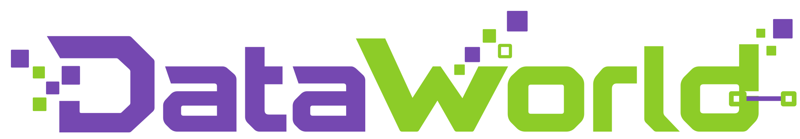

<div align="center">
  
  <p><strong>Scaling Data Environments from Scratch</strong></p>
  <p>先定义文件背后的世界，再生成数据，让监督有据可依。</p>
  <p>
    
    
    
  </p>
  <p><a href="README.md">English</a> · <strong>中文</strong></p>
  <p>
    <a href="#项目概览">项目概览</a> ·
    <a href="#快速开始">快速开始</a> ·
    <a href="doc/README.zh-CN.md">使用文档</a>
  </p>
</div>

---

## 项目概览

**Data World 是一个机制优先的多智能体引擎，从零合成数据分析环境、任务及评分细则。** 它不是先探索已有文件，再为碰巧发现的结论编写评分标准，而是先定义生成机制，构造一致的规范状态（canonical state），再生成包含现实观测缺陷的分析者可见数据。独立审计智能体检查指定关系，以及目标洞察能否从这些文件中复算得到。

产物不只是一组合成表格，而是一个**具有明确分析目标与验证依据的数据世界**，可用于数据智能体评测与基于 rubric 的奖励计算。

<p align="center">
  
  <br>
  <sub>从依赖 DAG 到观测文件、经审计的分析目标与任务级监督。</sub>
</p>

| 设计 | 带来的能力 |
|---|---|
| **先定义机制，再生成文件** | 世界契约预先约定实体、时间轴、生成关系、不变量与观测系统。 |
| **逐层构建规范状态** | 按 DAG 拓扑顺序生成各层；已提交的上游状态作为后续层的只读输入。 |
| **显式建模观测缺陷** | 缺失、延迟、标识符错配、重复与漂移来自明确的观测机制，而不只是任意加噪。 |
| **独立审计** | 独立智能体复查关系、全局不变量与目标可恢复性，记录审计结果并编写世界说明书。 |
| **有依据的评分细则** | 任务沿上游原因或下游后果展开；原子化评分项区分 `data_computation` 与 `insight_discovery`。 |

<details>
<summary><strong>为什么先定义世界，再生成文件？</strong></summary>

仅探索已有数据可能遗漏有效洞察，让这些结论没有对应的评分标准。Data World 利用生成记录建立选定目标及其评分依据，再审计这些目标是否能从观测文件中恢复。这并不保证覆盖所有可能成立的洞察。

<p align="center">
  
</p>

</details>

## 快速开始

### 1. 安装

在仓库根目录（包含 `pyproject.toml` 的目录）运行：

- 引擎需要 **Python 3.9+**。
- Claude Code CLI（`claude`）需要 **Node.js 18+ 与 npm**。
- 模型服务需支持**世界契约阶段的 OpenAI 兼容调用**和 **Claude Code 智能体阶段**；仅登录 Claude Code 并不能完成契约阶段的服务配置。

```bash
python -m pip install -e .
npm install -g @anthropic-ai/claude-code
```

可选轨迹采集需要 Node.js 22+ 与 `@musistudio/claude-code-router@3.0.20`；详见[轨迹采集与端点配置](doc/data-world.zh-CN.md)。

### 2. 配置模型服务

```bash
cp .env.example .env
chmod 600 .env
```

编辑 `.env`，填写 `ANTHROPIC_AUTH_TOKEN`、`ANTHROPIC_BASE_URL` 与 `ANTHROPIC_MODEL`。各 CLI 自动加载配置；不要通过命令行传递密钥，也不要提交密钥。可选 judge 覆盖配置见 [`.env.example`](.env.example)。

### 3. 生成数据世界

```bash
# 将 your-model-name 替换为 Claude Code 端点接受的模型名称或别名。
python -m data_world \
  --dag examples/agriculture_dag.json \
  --output outputs/agriculture-world \
  --persona "农业经营分析师" \
  --model your-model-name
```

`--model` 选择使用工具的 Claude Code 智能体模型（默认 `ops`）；世界契约模型单独默认读取 `.env` 中的 `ANTHROPIC_MODEL`。[`examples/`](examples/README.zh-CN.md) 中也提供了电商 DAG。

| 产物 | 面向对象与用途 |
|---|---|
| `outputs/agriculture-world/env/` | 分析者可见文件，是提供给求解智能体的数据。 |
| `outputs/agriculture-world/WORLD.md` | 供任务合成、审计与人工检查使用的世界说明书，不提供给求解者。 |
| `outputs/agriculture-world/dag.json` | 输入依赖 DAG 的原始副本。 |
| `outputs/agriculture-world/.build/` | 规范状态、世界契约、生成脚本、账本与审计记录，不提供给求解者。 |

**构建完成不代表所有审计项通过。** 筛选评测世界前，请检查 `.build/audit/audit_result.json`。

中断后，为同一生成命令追加 `--resume` 即可续跑。只有明确要删除并重建输出目录时才使用 `--force`。

### 4. 合成任务并导出评测目录

任务求解评测使用 [mini-swe-agent v2.4.6](https://github.com/SWE-agent/mini-swe-agent)；世界生成与任务合成使用 Claude Code。

```bash
# 读取已完成世界，生成任务及原子化评分细则。
python -m task synth \
  --worlds outputs/agriculture-world \
  --out tasks/agriculture \
  -v

# 导出任务目录与容器内 rubric 评分器。
python -m task export \
  --tasks tasks/agriculture \
  --out benchmark/agriculture
```

任务合成为每个世界写出 `tasks.json`，默认保留只读世界副本。如果使用 `--no-keep-copy`，导出时还需通过 `--world-root` 指向原始世界的父目录；详见[任务合成与导出](doc/task.zh-CN.md)。

> **导出前请注意：** Harbor 评测需要容器运行基础设施。当前 Dockerfile 模板使用内部基础镜像与内部软件镜像源，在外部环境构建前需适配。导出的任务目录还包含 `tests/judge.env` 中的真实 judge 凭据，不要直接公开或分享这些目录。

## 代码导航

三个组件通过 `dag.json` 与已完成的世界目录衔接：

**画像 / 领域 → `dag_factory` → `dag.json` → `data_world` → 世界 → `task synth` → 任务与 rubric → `task export` → Harbor**

| 组件 | 入口 | 职责 |
|---|---|---|
| [`dag_factory/`](dag_factory/README.zh-CN.md) | `python -m dag_factory` | 根据画像路由领域，生成并校验依赖 DAG。 |
| [`data_world/`](data_world/README.zh-CN.md) | `python -m data_world` | 将 DAG 编译为规范状态、观测文件与审计记录。 |
| [`task/`](task/README.zh-CN.md) | `python -m task` | 合成任务与 rubric，导出评测产物。 |

安装后提供 `dag-factory`、`data-world` 与 `data-world-task` 命令；`data-world-gen` 和 `python data_world_gen.py` 保留为兼容入口。

## 使用文档

- [文档索引](doc/README.zh-CN.md)
- [DAG 格式与 DAG Factory](doc/dag.zh-CN.md)：输入契约、生成模式与批量编排。
- [世界生成](doc/data-world.zh-CN.md)：参数、产物布局、自定义端点、续跑、轨迹与重试。
- [任务合成与 Harbor 导出](doc/task.zh-CN.md)：采样、产物布局、评分与凭据管理。
- [Rubric 设计](task/README.zh-CN.md)：评分分区、正负评分项与泄漏边界。
- [示例](examples/README.zh-CN.md) · [批量脚本](scripts/README.zh-CN.md)
